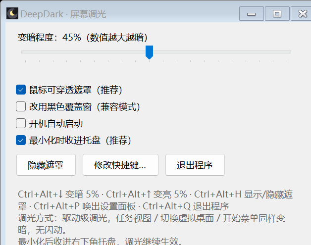
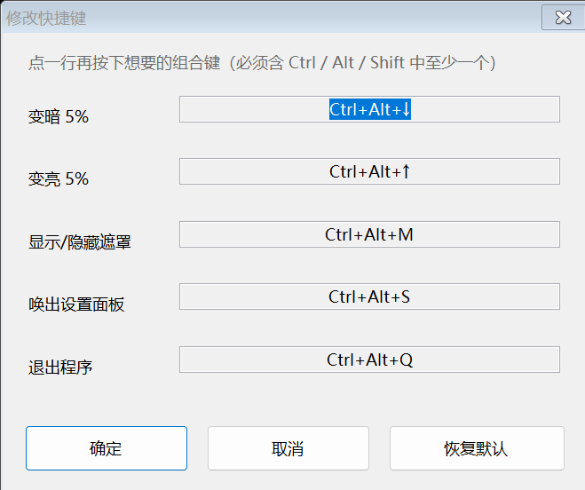

<div align="center">

# DeepDark

**让屏幕比显示器最低亮度还暗的 Windows 调光小工具**

单文件 · 免安装 · 无需管理员权限 · 内存约 5 MB · CPU 约 0.04% · GPU 0%

[](https://github.com/xiehuangsw/DeepDark/releases/latest)

[](https://github.com/xiehuangsw/DeepDark/actions/workflows/build.yml)
[](https://github.com/xiehuangsw/DeepDark/releases)
[](LICENSE)

[English](README.en.md) · 简体中文

</div>

---

显示器亮度已经调到最低还是刺眼？DeepDark 会在**显示器自身的亮度之下再压一层**，
把画面变得更暗，浓度随时可调。



## 为什么不用"盖一层黑窗口"

很多调光工具是在屏幕上盖一层半透明黑窗，结果**任务视图、切换虚拟桌面、开始菜单**
这些系统界面会盖在黑窗上面，闪一下、亮一下，晚上特别刺眼。

DeepDark 改的是**显卡输出的 gamma 查找表**——它在显卡扫描输出之前生效，
所以上述界面全都在同一档亮度下，**不闪动，也不存在"漏光"**。

如果系统不允许改 gamma（例如开启了 HDR），程序会自动改用黑色覆盖窗兜底，
并在面板上说明当前用的是哪种方式。

## 功能特性

- **驱动级调光**：0~95% 浓度实时可调，任务视图 / 虚拟桌面 / 开始菜单 / UAC 界面同样变暗
- **兼容模式**：检测到 HDR 或 gamma 被系统忽略时，自动回退到黑色覆盖窗
- **5 个全局快捷键，全部可自定义**；默认组合被占用时自动回退到备用组合
- **多显示器**：按显示器逐个处理，插拔 / 改分辨率后自动重建
- **托盘常驻**：最小化收进托盘，右键菜单可直接调亮度
- **开机自启**（可选）
- **崩溃自愈**：被强杀后下次启动会先还原屏幕再重新调光，不会"越压越暗"
- **一键救急**：屏幕被搞暗时双击 `屏幕偏暗时双击我恢复.cmd`

## 下载与安装

到 [Releases](https://github.com/xiehuangsw/DeepDark/releases) 下载 `DeepDark.exe`（或整个 zip），
解压到**普通目录**（桌面、`D:\DeepDark\` 均可），双击运行即可。无需安装、无需管理员权限。

> ⚠️ exe 没有代码签名，首次运行 Windows SmartScreen 可能提示"未知发布者"，选择"仍要运行"即可。
> 介意的话可以自行从源码构建。

## 使用说明

### 设置面板

| 控件 | 作用 |
| --- | --- |
| 变暗程度滑块 | 0 ~ 95%，数值越大越暗，实时生效 |
| 鼠标可穿透遮罩 | 默认勾选。只对"黑色覆盖窗"模式有效；关闭后覆盖窗会挡住鼠标点击（有二次确认） |
| 改用黑色覆盖窗 | 手动强制用覆盖窗机制调暗（一般不用勾） |
| 开机自动启动 | 写入当前用户的启动项，登录后自动运行 |
| 最小化时收进托盘 | 默认勾选：最小化后从任务栏消失，只留右下角托盘图标 |
| 隐藏遮罩 / 修改快捷键… / 退出程序 | 临时恢复正常画面 / 自定义快捷键 / 退出并还原屏幕 |

窗口可自由缩放，内容放不下时可用**鼠标滚轮**上下滚动（滚轮停在滑块上也是滚面板，不会误改数值）。

### 快捷键（可自定义）

| 功能 | 默认键 |
| --- | --- |
| 变暗 5% | `Ctrl+Alt+↓` |
| 变亮 5% | `Ctrl+Alt+↑` |
| 显示 / 隐藏遮罩 | `Ctrl+Alt+M` |
| 唤出设置面板 | `Ctrl+Alt+S` |
| 退出并还原 | `Ctrl+Alt+Q` |

默认组合若被其它程序占用，会自动回退（`Ctrl+Shift+↓`、`Ctrl+Alt+H` …），实际键位显示在面板第一行。
点 **"修改快捷键…"**：窗口里点一行、直接按下想要的组合键（必须含 `Ctrl`/`Alt`/`Shift` 之一），
被占用会提示更换，确定后立即生效并记住。



### 命令行

```
DeepDark.exe                 沿用上次的浓度
DeepDark.exe --level=70      指定变暗程度 0~95
DeepDark.exe --restore       把 gamma 恢复成正常曲线（屏幕被搞暗时救急）
```

再双击一次 `DeepDark.exe` 可以唤出已在运行的面板，不会启动第二个实例。

## 适配范围

| 项目 | 支持情况 |
| --- | --- |
| Windows 11 | ✅ 实测通过（2560×1600 @150%） |
| Windows 10 | ✅ 所用 API 自 Vista 起就有，理论 1809+ 可用 |
| 笔记本内屏 / 外接显示器 / 多屏 | ✅ 按显示器逐个处理，各自独立 |
| 显卡 | ✅ Intel / AMD / NVIDIA / 高通通用，走系统 API，不依赖厂商驱动 |
| 混合显卡（核显+独显笔记本） | ✅ 调的是显示器输出通道，与谁在渲染无关 |
| 台式机 | ✅ 与笔记本同一套代码 |
| 高 DPI / 缩放 | ✅ 界面按字体实测排版，150% / 200% 都不裁切 |
| **HDR / 高级颜色开启** | ⚠️ 系统会忽略 gamma，程序自动改用黑色覆盖窗，此时任务视图、切换桌面可能短暂漏光；想完全无闪动请关闭 HDR |
| Windows"夜灯 / 夜间模式" | ⚠️ 两者共用同一套 gamma 表，本程序会覆盖夜灯色温，建议二选一 |
| 独占全屏游戏 | ⚠️ 游戏可能自行重设 gamma，程序每 10 秒检测并纠正；改成"无边框窗口"更稳 |
| 锁屏、UAC 安全桌面、开始菜单、虚拟桌面动画 | ✅ gamma 在扫描输出前生效，这些界面同样变暗 |

## 常见问题

| 情况 | 处理 |
| --- | --- |
| 屏幕一直偏暗，程序已不在运行 | 双击 `屏幕偏暗时双击我恢复.cmd`（= `DeepDark.exe --restore`） |
| 误关了"鼠标穿透"，鼠标点不动 | 按"显示/隐藏遮罩"快捷键，或按"退出"快捷键 |
| 被任务管理器强杀过 | 启动时会先自动还原再重新调光，不会越压越暗 |
| 右下角看不到托盘图标 | Windows 11 默认把新图标收进 ∧ 隐藏区，点开 ∧ 把 DeepDark 拖到任务栏即可 |
| 想让程序忘掉上次设置 | 删掉程序目录下的 `DeepDark.settings` |

## 从源码构建

只需要 Windows 自带的 .NET Framework 编译器，**零第三方依赖**：

```powershell
git clone https://github.com/xiehuangsw/DeepDark.git
cd DeepDark
powershell -ExecutionPolicy Bypass -File build.ps1
# 产物：dist\DeepDark.exe
```

仓库结构：

```
DeepDark/
├─ src/DeepDark.cs              单文件源码（WinForms，约 2000 行）
├─ assets/                      图标与界面截图
├─ build.ps1                    一键编译（用系统自带 csc.exe）
├─ .github/workflows/build.yml  打 tag 时自动编译并发布
└─ LICENSE                      MIT
```

## 实现要点

- **调光**：`gdi32!SetDeviceGammaRamp`，按比例缩放当前 gamma 曲线（保留夜灯色调），
  并缓存每个显示器的 DC 以避免反复 `CreateDC`
- **HDR 检测**：`user32!QueryDisplayConfig` 的 `GET_ADVANCED_COLOR_INFO`
- **兜底覆盖窗**：置顶 `WS_EX_LAYERED` 黑窗 + `WS_EX_TRANSPARENT` 鼠标穿透
- **响应系统变化**：`WM_DISPLAYCHANGE` / `WM_SETTINGCHANGE` / `WM_POWERBROADCAST` 事件驱动，
  巡检仅 10 秒一次兜底
- **省内存**：启动、最小化、每 10 分钟调用 `EmptyWorkingSet` 归还闲置工作集；运行时关闭并发 GC

## 开源协议

[MIT](LICENSE)

欢迎提交 [Issue](https://github.com/xiehuangsw/DeepDark/issues) 与 PR，参与方式见 [CONTRIBUTING.md](CONTRIBUTING.md)。
